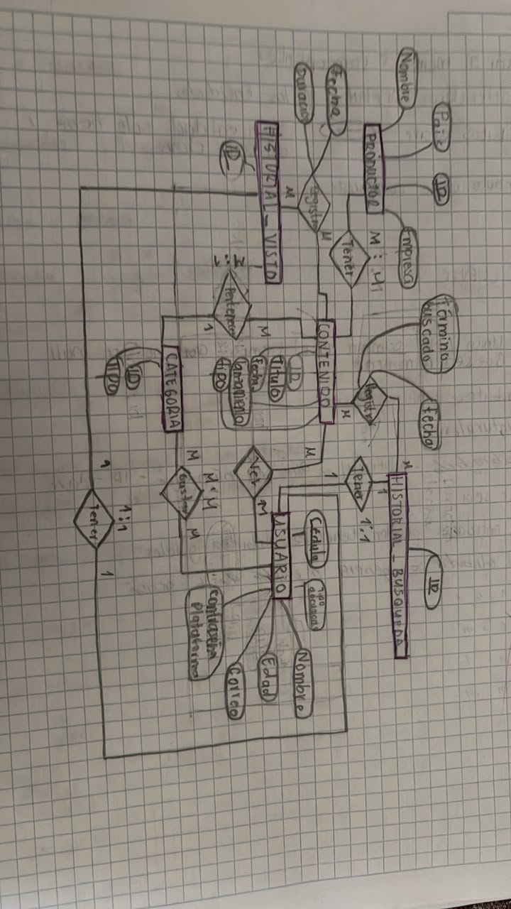

---
title: 'Modelo Entidad-Relación'
summary: 'Diseño de un diagrama de ER de Chen para un sistema de una Plataforma Streaming para La Universidad del Bosque, identificando entidades, atributos y relaciones antes de pasar a la base de datos.'
cover: ../../assets/images/projects/modelo-entidad-relacion.jpeg
coverAlt: 'Diagrama de modelo entidad-relación'
tech: ['Modelado de datos', 'Bases de Datos']
role: 'Diseño y modelado'
year: 2026
featured: true
---

En las últimas clases aprendimos el concepto del modelo entidad-relación y lo aplicamos a ejercicios propuestos por el profesor. Este es uno de los ejemplos realizados.

## ¿Qué es el modelo entidad-relación?

El modelo entidad-relación nos permite planificar cómo quedará nuestra base de datos, para que sea funcional y optimizada.

Los elementos que constituyen el modelo entidad-relación son:

- Entidades
- Atributos
- Llaves primarias
- Relaciones
- Cardinalidades

## Entidades y relaciones

### Entidades

- **Usuario**: cédula, tipo de documento, nombre, edad, correo, contraseña de la plataforma.
- **Contenido**: ID, título, fecha de lanzamiento, tipo.
- **Categoría**: ID, tipo.
- **Productor**: ID, nombre, país, empresa.
- **Historial_Búsqueda**: ID.
- **Historial_Visto**: ID.

### Relaciones

- **Productor – Contenido**: Tener (M:M).
- **Historial_Búsqueda – Contenido**: Registra (M:M) — atributos: término buscado, fecha.
- **Historial_Búsqueda – Usuario**: Tener (1:1).
- **Historial_Visto – Contenido**: Registra (M:M) — atributos: fecha, duración.
- **Historial_Visto – Usuario**: Tener (1:1).
- **Usuario – Contenido**: Ver (M:M).
- **Usuario – Categoría**: Gustar (M:M).
- **Contenido – Categoría**: Pertenece (M:M).

## Decisiones de diseño

Fue un diseño con un enunciado que se puede interpretar de varias maneras; este fue el resultado de mi interpretación. Sin embargo, lo que más se me dificultó fue saber cómo ajustar las cardinalidades a las diferentes relaciones y decidir si debía usar una entidad o, en su lugar, un atributo. Finalmente, socializamos e hicimos un debate acerca de este ejercicio.

## Ejemplo de trabajo

## Conclusión

Fue el primer ejercicio propuesto en clase. Al ser tan general, no se esperaba un resultado específico, sino más bien ver cómo los demás llegan a diferentes resultados a pesar de partir de un mismo enunciado.

