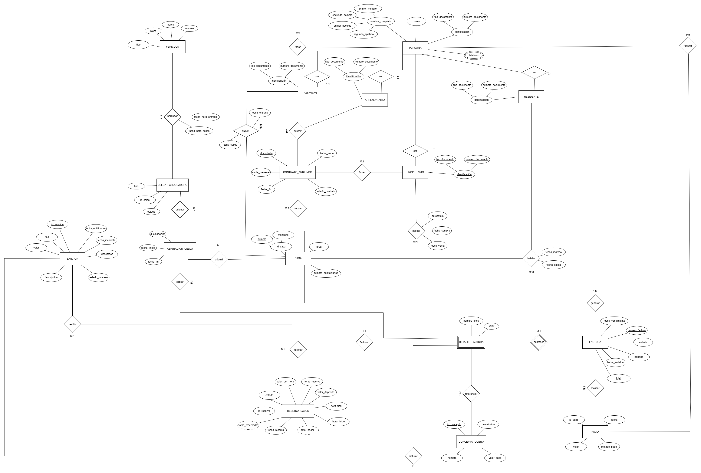
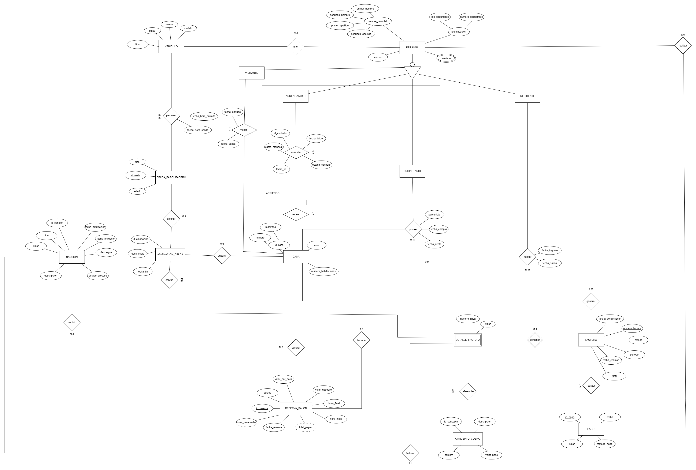

Este fue el proyecto final de **Bases de Datos 1**: diseñar e implementar la base de datos de un conjunto residencial de casas. Lo hicimos Isabella Moreno Pérez, Sofia Moreno Pérez y José Manuel Cipagauta Toro, con el docente Christian Felipe Duarte. La base de datos está en **PostgreSQL**, el backend en **Javalin** y el frontend en **Angular**.

## El problema

Los conjuntos residenciales de casas suelen manejar su administración de forma manual y dispersa: hojas de cálculo, cuadernos, mensajes de WhatsApp y carpetas físicas. Eso genera desorden, cobros a la persona equivocada, conflictos por el parqueadero y el salón comunal, sanciones sin proceso y falta de trazabilidad.

La pregunta que guió el proyecto fue: **¿cómo centralizar la información de un conjunto residencial para que la administración pueda consultarla de forma confiable, aplicar sus reglas de negocio y tomar decisiones informadas?**

## Objetivos

Diseñar e implementar una base de datos relacional que centralice y controle la administración de un conjunto residencial de casas, con consultas confiables y validación de reglas de negocio. Para lograrlo nos propusimos:

- Modelar casas, propietarios, arrendatarios y residentes, conservando el historial de propiedad y de ocupación.
- Gestionar facturas, pagos y cartera por casa, diferenciando quién responde por la deuda de quién paga.
- Controlar el parqueadero (celdas, vehículos y parqueos) y las visitas a las casas.
- Administrar las reservas del salón comunal, validando disponibilidad, cartera y sanciones.
- Registrar las sanciones con su proceso de notificación, descargos y decisión.
- Elaborar los modelos entidad-relación (Chen y extendido), pasarlos al modelo relacional y normalizarlos hasta la Tercera Forma Normal.
- Implementar la base de datos y conectarla a una aplicación web.

## Supuestos

Para delimitar el diseño partimos de **41 supuestos**. Son la base de todo el modelo.

### Casas y personas

- **S-1.** El conjunto es cerrado y está formado solo por casas; cada casa se identifica con una nomenclatura única, formada por la manzana y el número.
- **S-20.** Propietario, Arrendatario, Residente y Visitante son roles de Persona, cada uno con relaciones propias (Poseer y Firmar, Asumir, Habitar, Visitar). Los roles no son excluyentes: una persona puede tener varios a la vez, por ejemplo ser propietaria de una casa y arrendataria de otra, o no tener ninguno.
- **S-21.** Las personas que ingresan al conjunto para visitar una casa se registran con sus datos de identificación y nombre, y se les asigna el rol de visitante. Para registrar una visita, la persona debe tener el rol de visitante. El sistema conserva el historial de visitas, y la asignación o retiro de roles se gestiona mediante los registros correspondientes.
- **S-22.** La persona se identifica por su documento (tipo y número) y puede tener varios teléfonos.

### Propiedad, arriendo y residencia

- **S-3.** Una casa puede tener uno o varios propietarios, cada uno con su porcentaje de participación. La suma de los porcentajes de participación vigentes no puede superar el 100 %. Asimismo, una casa puede tener, como máximo, un contrato de arriendo vigente.
- **S-4.** Una misma persona puede ser propietaria de varias casas y, a la vez, arrendataria de otra.
- **S-24.** Los contratos de arriendo y los registros de residencia se gestionan de forma independiente en el sistema. La existencia de un contrato de arriendo no genera automáticamente un registro de residencia para el arrendatario.
- **S-39.** Una persona puede ser propietaria de una casa y arrendataria de otra. Para una misma casa, el arrendatario de un contrato de arriendo no puede figurar como propietario.
- **S-40.** La propiedad de una casa y la residencia en ella se registran de forma independiente en el sistema. Una persona propietaria puede registrarse también como residente de la casa en la que vive.
- **S-41.** Las personas que viven en una casa pueden registrarse como residentes de ella, independientemente de que estén incluidas o no en el contrato de arriendo. El registro de residencia se gestiona de forma independiente al contrato.

### Historial

- **S-25.** Se conserva el historial de propiedad, ocupación, visitas, parqueos y asignaciones de celdas mediante sus fechas. Una misma persona puede volver a ser propietaria de la misma casa en otro periodo. Al finalizar una visita, un parqueo o una ocupación, el registro se cierra mediante la fecha correspondiente, conservando su historial.

### Cobros, facturación y pagos

- **S-2.** La cuota de administración de cada casa se define conforme al reglamento de propiedad horizontal y se registra como valor base en el concepto de cobro correspondiente.
- **S-5.** La deuda de administración se asigna a la casa, de la cual responde su propietario, aunque el pago pueda ser realizado por otra persona, como el arrendatario. Este criterio se ajustará al reglamento del conjunto y a la normativa aplicable.
- **S-6.** Las cuotas de administración corresponden a un cobro mensual. El sistema permite registrar cuotas de administración y otros conceptos de cobro, como cuotas extraordinarias, multas y reservas del salón, mediante el registro de los conceptos y detalles de facturación correspondientes.
- **S-26.** El valor total de cada factura se calcula sumando los valores de sus líneas de detalle, y cada línea se asocia a un concepto del catálogo de cobros. Cada línea registra el valor correspondiente al cobro en el momento de la facturación, de manera que se conserva el importe registrado aunque posteriormente cambie la tarifa del concepto.
- **S-27.** Una factura puede recibir varios pagos (abonos). Cada pago registra quién lo realizó, que puede ser el propietario, el arrendatario u otra persona.
- **S-28.** Los cobros de sanciones, reservas del salón comunal y asignaciones de celdas adicionales se registran como líneas de detalle de una factura de la casa, cada una con su concepto de cobro ("Sanción", "Salón comunal" y "Parqueadero adicional") y ligada a la sanción, la reserva o la asignación correspondiente, que debe pertenecer a la misma casa. Solo se cobra una sanción confirmada con multa, no se cobra una reserva cancelada, y una sanción o una reserva no se cobra más de una vez.
- **S-29.** Una línea de factura puede corresponder a una reserva del salón, a una sanción (cuando esta genera una multa) o a una asignación de celda adicional, pero como máximo a una de ellas. Las demás líneas, como la administración mensual o las cuotas extraordinarias, no están ligadas a ninguna de las tres y se cobran solo con su concepto de cobro.
- **S-35.** Cada concepto de cobro tiene un nombre, una descripción y un valor base, que sirven para calcular los cobros de las facturas.
- **S-36.** Las facturas y las reservas tienen un estado que refleja su situación. Las facturas pueden estar PENDIENTE, ABONADA, PAGADA o VENCIDA; las reservas, CONFIRMADA, CANCELADA, FINALIZADA o DEPOSITO_RETENIDO.

### Parqueadero y visitas

- **S-7.** El conjunto residencial cuenta con celdas de parqueadero de tres tipos: propias, adicionales y de visitantes. Las celdas se asignan a las casas con fecha de inicio y de fin, y las asignaciones de celdas adicionales generan una cuota extra. Una celda puede tener, como máximo, una asignación vigente a la vez. La verificación automática de que una celda propia o asignada no sea usada por otras personas queda como ampliación futura.
- **S-8.** El registro de vehículos asociados a visitas permite llevar el control de su ingreso al parqueadero del conjunto residencial. La configuración de un tiempo máximo de permanencia para estos vehículos se considera una ampliación futura del sistema.
- **S-23.** El sistema permite registrar los parqueos de vehículos en las celdas del conjunto residencial, relacionando el vehículo con la celda y con las fechas y horas de entrada y de salida. Los parqueos y las visitas se gestionan de forma independiente; la verificación de que un parqueo de visitante corresponda a una visita vigente queda como ampliación futura.
- **S-30.** Todo vehículo pertenece a una persona (propietario, arrendatario, residente o visitante) y se registra una sola vez, por su placa.
- **S-31.** Cada vez que un vehículo ingresa al conjunto se registra un parqueo con el vehículo, la celda y la fecha y hora de entrada, y se cierra al salir con la fecha y hora de salida. Esto aplica a todos los vehículos, tanto de residentes como de visitantes, sin importar cuánto tiempo permanezcan. El vehículo se registra una sola vez, pero cada ingreso genera un parqueo.
- **S-32.** Cada ingreso de un vehículo genera un registro de parqueo que se cierra al salir. Un vehículo no puede tener dos parqueos abiertos a la vez, ni una celda puede tener dos parqueos abiertos a la vez. Usar el parqueadero no convierte a una persona en visitante: ese rol se asigna mediante el registro de roles.
- **S-33.** Las asignaciones de celdas a las casas se registran con fecha de inicio y fecha de fin, que queda vacía mientras la asignación esté vigente, conservando el historial. Cada celda tiene un tipo (propia, adicional o de visitantes) y un estado (ocupada o desocupada), y puede tener, como máximo, una asignación vigente y un parqueo abierto a la vez. La cuota adicional de parqueadero se cobra mediante una línea de factura con el concepto "Parqueadero adicional", ligada a la asignación correspondiente; la generación automática mensual de ese cobro queda como ampliación futura.
- **S-34.** Cada visita se registra con el visitante, la casa visitada y las fechas de entrada y de salida.
- **S-37.** Los vehículos se identifican por su placa y registran su tipo, marca y modelo.

### Salón comunal

- **S-9.** El salón comunal se reserva por franjas horarias, definidas por una hora de inicio y una hora final. Cada reserva se asocia a una casa y registra el depósito de garantía correspondiente. Las horas reservadas y el total a pagar se calculan a partir de la hora de inicio, la hora final y el valor por hora, sin almacenarse como datos independientes.
- **S-10.** Las restricciones para reservar el salón comunal por mora en la cartera o por sanciones pendientes se determinan según el estado de las facturas y las sanciones registradas para la casa.
- **S-38.** El valor del depósito de garantía se registra en la reserva, y su devolución o retención se refleja en el estado de la reserva. La sanción registra su tipo, descripción, fecha del incidente, fecha de notificación, descargos, valor de la multa (si lo hay) y el estado de su proceso.

### Sanciones

- **S-11.** Toda sanción se impone a una casa y sigue un proceso de notificación, descargos y decisión, y queda registrada con sus fechas y el estado de su proceso. (Los datos que registra la sanción están en S-38.)

### Datos, alcance e implementación

- **S-12.** Los datos personales almacenados corresponden a los necesarios para la administración del conjunto residencial, procurando limitar su recopilación a la información requerida para las funciones del sistema y respetando la normativa aplicable sobre protección de datos personales.
- **S-13.** Para las pruebas se utilizarán datos ficticios.
- **S-14.** El esquema se normalizará mínimo hasta la Tercera Forma Normal (3FN) antes de su implementación.
- **S-15.** La base de datos se implementará en una máquina virtual con una distribución Linux o Unix (por ejemplo, Oracle Linux) y un RDBMS diferente de SQL Server; ambas decisiones se justifican en los documentos de análisis de la segunda fase.
- **S-16.** La aplicación web permite consultar y administrar los datos principales del conjunto residencial mediante las operaciones implementadas en el sistema.
- **S-17.** El proyecto lo desarrolla un equipo de tres estudiantes, que gestionan el código y la documentación en un repositorio de GitHub.
- **S-18.** No se registran las condiciones económicas de la compraventa de las casas (precio, pagos, créditos hipotecarios), pues corresponden a un negocio entre particulares y no a la administración del conjunto.
- **S-19.** Los módulos de proveedores, contratos de servicios, recolección de basuras, reclamos de posventa a la constructora, mantenimiento, empleados, asamblea y votaciones, PQRS y auditoría quedan fuera del alcance del proyecto y se consideran posibles ampliaciones futuras.

## Los modelos

Del análisis salieron tres modelos: el entidad-relación en notación Peter Chen, el entidad-relación extendido y el modelo relacional en Crow's Foot, normalizado hasta 3FN.

### Modelo entidad-relación (Peter Chen)

### Modelo entidad-relación extendido

### Modelo relacional (Crow's Foot)

  
Modelo relacional

  

    <a class="download-btn" href="/descargas/MR.zip" download>↓ Modelo relacional</a>
  

## El esquema final

La base de datos quedó con **21 tablas**:

- **Personas y roles:** persona, propietario, arrendatario, residente, visitante y telefono.
- **Casas:** casa, posesion, arriendo y residencia.
- **Parqueadero y visitas:** vehiculo, celda_parqueadero, asignacion_celda, parqueo y visita.
- **Finanzas:** concepto_cobro, factura, detalle_factura y pago.
- **Salón comunal:** reserva_salon.
- **Sanciones:** sancion.

## Cómo está hecho

- **Base de datos:** PostgreSQL.
- **Backend:** Javalin.
- **Frontend:** Angular.

## Archivos del proyecto

Aquí puedes descargar el script de la base de datos y ver el código en GitHub.

  
Base de datos y código

  

    <a class="download-btn" href="/descargas/conjuntoddl.sql" download>↓ Script DDL · PostgreSQL</a>
    <a class="download-btn" href="https://github.com/JMCip/conjunto-residencial">Ver en GitHub</a>
  

## Conclusión

Fue un trabajo bastante complejo, pues era necesario hacerlo bien desde el primer ajuste. Como grupo trabajamos muy bien y de manera organizada: no estuvimos corriendo a lo último, sino que ya teníamos todo listo. Primero hicimos los modelos y la normalización, y luego pasamos a la parte física, donde creamos la base de datos, después el backend y, finalmente, el frontend.