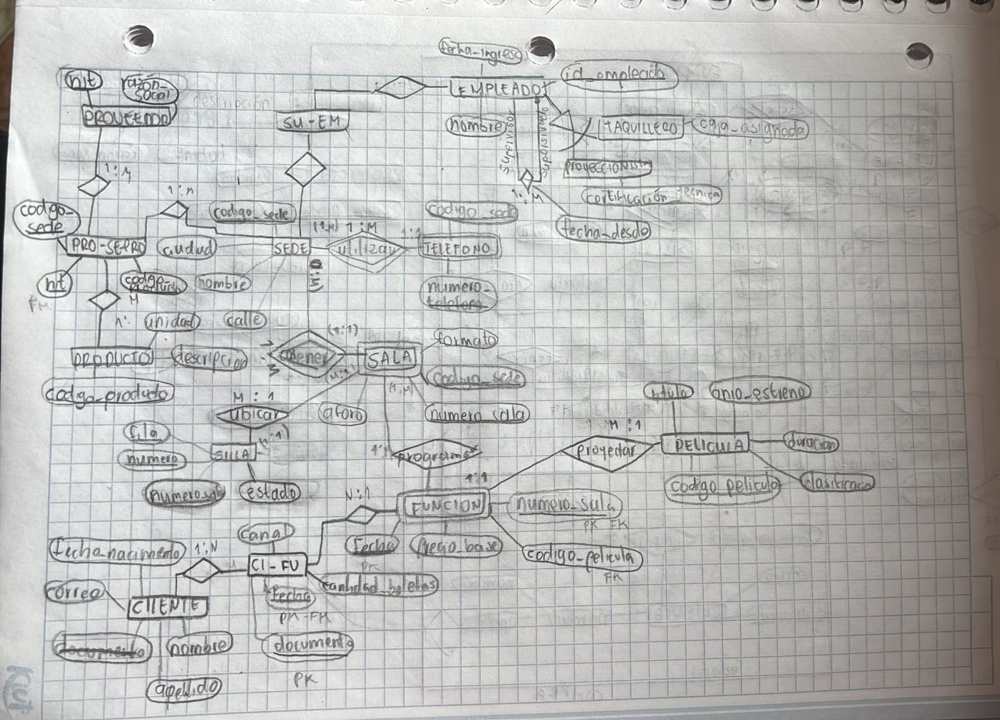

El 12 de septiembre nos dieron una propuesta de trabajo. Como se venía pronto nuestro primer parcial, hicimos un simulacro de cómo sería el próximo. El primer punto es de **Transformación Extendida**: una cadena de salas de cine, **CineAndes**, que tiene sedes, salas, sillas, películas, funciones, clientes y empleados, necesita un modelo conceptual que cumpla unas reglas de negocio. A continuación se presentan las relaciones y restricciones para realizarlo.

## Las restricciones con las que vamos a trabajar

**PUNTO 1 — Diseño del modelo entidad–relación extendido (20 puntos)**

La cadena de salas de cine CineAndes necesita un modelo conceptual que cumpla las siguientes reglas de negocio.

**a.** De cada SEDE se registra un código, un nombre, la dirección —compuesta por ciudad y calle— y uno o varios teléfonos de contacto.

**b.** Cada sede tiene varias SALAS. Dentro de una sede las salas se numeran 1, 2, 3 y así sucesivamente, y ese número solo tiene sentido dentro de su propia sede: la sala 3 de Bogotá y la sala 3 de Medellín son salas distintas. De cada sala se registra el formato de proyección y el aforo.

**c.** Cada sala está compuesta por SILLAS. Una silla se identifica por su fila y su número, que solo tienen sentido dentro de su sala. De cada silla se registra si está habilitada o fuera de servicio.

**d.** De cada PELÍCULA se registra un código, el título, el año de estreno, la duración en minutos y la clasificación. Una película puede estar disponible en uno o varios idiomas. La antigüedad de la película se obtiene a partir de su año de estreno. Además, una película puede ser la secuela de otra ya registrada en el catálogo, y tiene a lo sumo una precuela.

**e.** Una FUNCIÓN es la proyección de una película en una sala determinada, en una fecha y una hora. Dentro de una misma sala, la fecha y la hora identifican la función. De cada función se registra el precio base de la boleta. Toda función proyecta exactamente una película; una película puede no haberse programado nunca.

**f.** De cada CLIENTE se registra el documento, el nombre completo —nombres y apellidos por separado—, el correo y la fecha de nacimiento. La edad del cliente se obtiene de su fecha de nacimiento.

**g.** Un cliente puede comprar boletas para muchas funciones y una función puede tener muchos clientes. De cada compra se registra la cantidad de boletas y el canal por el que se hizo. Un cliente puede no haber comprado nunca.

**h.** De cada EMPLEADO se registra un identificador, el nombre y la fecha de ingreso. Todo empleado es proyeccionista, del que se registra su certificación técnica, o taquillero, del que se registra la caja asignada. Ningún empleado puede ser las dos cosas al mismo tiempo, y no existen empleados que no sean ni lo uno ni lo otro.

**i.** Un empleado supervisa a otros empleados. Un empleado tiene a lo sumo un supervisor, y de esa supervisión se registra la fecha desde la cual se ejerce.

**j.** Para la confitería, un PROVEEDOR entrega un PRODUCTO a una SEDE. Un mismo producto puede ser entregado por proveedores distintos a la misma sede, cada proveedor atiende muchas sedes y muchos productos, y de cada entrega se registran la cantidad y la fecha.

**k.** Cada compra que un cliente hace para una función determinada se paga con un único MEDIO DE PAGO. Un mismo medio de pago se usa en muchas compras. El medio de pago corresponde a esa compra concreta, no al cliente ni a la función por separado.

## Aquí están las preguntas a resolver

**Se pide:**

**a.** Dibuje el modelo entidad–relación completo en notación de Peter Chen. (10 puntos)

**b.** Subraye los atributos clave y marque explícitamente los atributos compuestos, multivaluados y derivados. (2 puntos)

**c.** Indique la cardinalidad y la participación de todas las relaciones. (3 puntos)

**d.** Identifique todas las entidades débiles del modelo, señale de qué entidad depende cada una en identificación y cuál es su clave parcial. Explique en dos líneas qué ocurre con la identificación de SILLA, cuya entidad propietaria es a su vez débil. (3 puntos)

**e.** Indique los nombres de rol de las dos relaciones recursivas del modelo. (1 punto)

**f.** Justifique en dos líneas por qué la regla 11 exige una agregación y no una relación ternaria entre CLIENTE, FUNCIÓN y MEDIO DE PAGO. (1 punto)

## Solución

## Decisiones de diseño

### La entidad débil SILLA

La clave de SILLA está compuesta por su clave parcial (fila y número), la clave parcial de SALA (el número de sala) y la clave de SEDE (el código). La identificación funciona como una cadena: **SEDE → SALA → SILLA**. Como SALA ya es débil de SEDE, SILLA hereda toda esa cadena de identificación.

### Agregación y no relación ternaria

Se usa una **agregación** porque una relación (la compra entre CLIENTE y FUNCIÓN) debe participar en otra relación con algo que no es una entidad de esa misma relación (MEDIO DE PAGO). Una relación ternaria no lo expresa bien: el medio de pago corresponde a la compra concreta, no al cliente ni a la función por separado.

### Relación recursiva de EMPLEADO

Los roles son **Supervisor** y **Supervisado**: un empleado (supervisor) supervisa a otro empleado (supervisado).