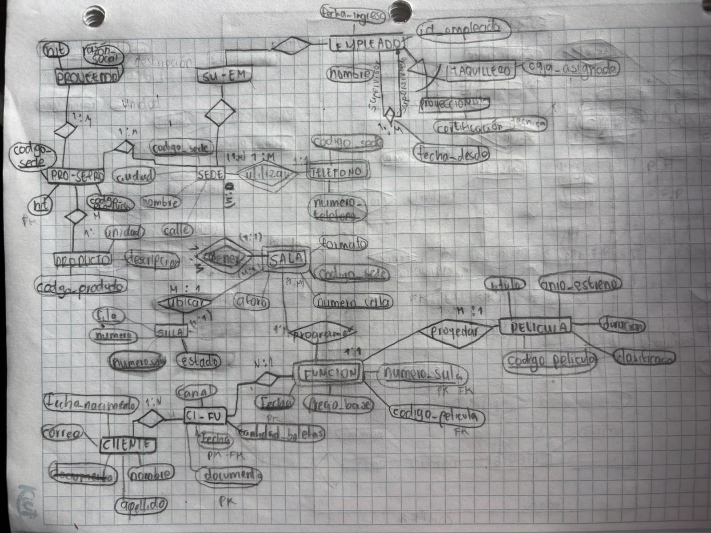

El 12 de septiembre nos dieron una propuesta de trabajo. Como se venía pronto nuestro primer parcial, hicimos un simulacro de cómo sería el próximo. El primer punto es de **Transformación Extendida**: una cadena de salas de cine, **CineAndes**, que tiene sedes, salas, sillas, películas, funciones, clientes y empleados, necesita un modelo conceptual que cumpla unas reglas de negocio. A continuación se presentan las relaciones y restricciones para realizarlo.

## Las restricciones con las que vamos a trabajar

**PUNTO 1 — Diseño del modelo entidad–relación extendido (20 puntos)**

La cadena de salas de cine CineAndes necesita un modelo conceptual que cumpla las siguientes reglas de negocio.

**a.** De cada SEDE se registra un código, un nombre, la dirección —compuesta por ciudad y calle— y uno o varios teléfonos de contacto.

**b.** Cada sede tiene varias SALAS. Dentro de una sede las salas se numeran 1, 2, 3 y así sucesivamente, y ese número solo tiene sentido dentro de su propia sede: la sala 3 de Bogotá y la sala 3 de Medellín son salas distintas. De cada sala se registra el formato de proyección y el aforo.

**c.** Cada sala está compuesta por SILLAS. Una silla se identifica por su fila y su número, que solo tienen sentido dentro de su sala. De cada silla se registra si está habilitada o fuera de servicio.

**d.** De cada PELÍCULA se registra un código, el título, el año de estreno, la duración en minutos y la clasificación. Una película puede estar disponible en uno o varios idiomas. La antigüedad de la película se obtiene a partir de su año de estreno. Además, una película puede ser la secuela de otra ya registrada en el catálogo, y tiene a lo sumo una precuela.

**e.** Una FUNCIÓN es la proyección de una película en una sala determinada, en una fecha y una hora. Dentro de una misma sala, la fecha y la hora identifican la función. De cada función se registra el precio base de la boleta. Toda función proyecta exactamente una película; una película puede no haberse programado nunca.

**f.** De cada CLIENTE se registra el documento, el nombre completo —nombres y apellidos por separado—, el correo y la fecha de nacimiento. La edad del cliente se obtiene de su fecha de nacimiento.

**g.** Un cliente puede comprar boletas para muchas funciones y una función puede tener muchos clientes. De cada compra se registra la cantidad de boletas y el canal por el que se hizo. Un cliente puede no haber comprado nunca.

**h.** De cada EMPLEADO se registra un identificador, el nombre y la fecha de ingreso. Todo empleado es proyeccionista, del que se registra su certificación técnica, o taquillero, del que se registra la caja asignada. Ningún empleado puede ser las dos cosas al mismo tiempo, y no existen empleados que no sean ni lo uno ni lo otro.

**i.** Un empleado supervisa a otros empleados. Un empleado tiene a lo sumo un supervisor, y de esa supervisión se registra la fecha desde la cual se ejerce.

**j.** Para la confitería, un PROVEEDOR entrega un PRODUCTO a una SEDE. Un mismo producto puede ser entregado por proveedores distintos a la misma sede, cada proveedor atiende muchas sedes y muchos productos, y de cada entrega se registran la cantidad y la fecha.

**k.** Cada compra que un cliente hace para una función determinada se paga con un único MEDIO DE PAGO. Un mismo medio de pago se usa en muchas compras. El medio de pago corresponde a esa compra concreta, no al cliente ni a la función por separado.

## Aquí están las preguntas a resolver

**Se pide:**

**a.** Dibuje el modelo entidad–relación completo en notación de Peter Chen. (10 puntos)

**b.** Subraye los atributos clave y marque explícitamente los atributos compuestos, multivaluados y derivados. (2 puntos)

**c.** Indique la cardinalidad y la participación de todas las relaciones. (3 puntos)

**d.** Identifique todas las entidades débiles del modelo, señale de qué entidad depende cada una en identificación y cuál es su clave parcial. Explique en dos líneas qué ocurre con la identificación de SILLA, cuya entidad propietaria es a su vez débil. (3 puntos)

**e.** Indique los nombres de rol de las dos relaciones recursivas del modelo. (1 punto)

**f.** Justifique en dos líneas por qué la regla 11 exige una agregación y no una relación ternaria entre CLIENTE, FUNCIÓN y MEDIO DE PAGO. (1 punto)

## Solución


## Decisiones de diseño

### La entidad débil SILLA

La clave de SILLA está compuesta por su clave parcial (fila y número), la clave parcial de SALA (el número de sala) y la clave de SEDE (el código). La identificación funciona como una cadena: **SEDE → SALA → SILLA**. Como SALA ya es débil de SEDE, SILLA hereda toda esa cadena de identificación.

### Agregación y no relación ternaria

Se usa una **agregación** porque una relación (la compra entre CLIENTE y FUNCIÓN) debe participar en otra relación con algo que no es una entidad de esa misma relación (MEDIO DE PAGO). Una relación ternaria no lo expresa bien: el medio de pago corresponde a la compra concreta, no al cliente ni a la función por separado.

### Relación recursiva de EMPLEADO

Los roles son **Supervisor** y **Supervisado**: un empleado (supervisor) supervisa a otro empleado (supervisado).


---

## Punto 2 — Reducción a tablas (20 puntos)

Independientemente de lo que haya dibujado en el punto anterior, para este punto utilice el modelo que se describe a continuación. Este modelo es correcto y está validado: su tarea no es rediseñarlo ni corregirlo, sino transformarlo aplicando las reglas de reducción a tablas.

**Modelo de partida**

```
SEDE (codigo_sede, nombre, direccion, telefono)
    direccion es compuesto: ciudad, calle
    telefono es multivaluado
SALA (numero_sala, formato, aforo)
    entidad débil dependiente en identificación de SEDE
SILLA (fila, numero, estado)
    entidad débil dependiente en identificación de SALA
CLIENTE (documento, nombre_completo, correo, fecha_nacimiento, edad)
    nombre_completo es compuesto: nombres, apellidos
    edad es derivado de fecha_nacimiento
FUNCION (fecha, hora, precio_base)
    entidad débil dependiente en identificación de SALA
PELICULA (codigo_pelicula, titulo, anio_estreno, duracion, clasificacion)
EMPLEADO (id_empleado, nombre, fecha_ingreso)
PROVEEDOR (nit, razon_social)
PRODUCTO (codigo_producto, descripcion, unidad)
MEDIO_PAGO (codigo_medio, tipo, franquicia)
```

**Relaciones**

```
1. CONTIENE    SEDE (1) — (N) SALA          · identificadora · SALA total
2. UBICA       SALA (1) — (N) SILLA         · identificadora · SILLA total
3. PROGRAMA    SALA (1) — (N) FUNCION       · identificadora · FUNCION total
4. PROYECTA    PELICULA (1) — (N) FUNCION   · FUNCION total · PELICULA parcial
5. COMPRA      CLIENTE (M) — (N) FUNCION
```

**6. SUPERVISA** — EMPLEADO (1) — (N) EMPLEADO · recursiva · roles: supervisor / supervisado · atributo: fecha_desde

**7. ENTREGA** — ternaria PROVEEDOR — SEDE — PRODUCTO (M : N : N) · atributos: cantidad, fecha_entrega

**8. PAGA_CON** — agregación: la participación de un CLIENTE en una FUNCION (relación COMPRA) se paga con un único MEDIO_PAGO; un medio de pago se usa en muchas compras. (N) — (1)

**9. ESPECIALIZACIÓN** — EMPLEADO → PROYECCIONISTA (certificacion_tecnica), EMPLEADO → TAQUILLERO (caja_asignada) · jerarquía TOTAL y DISJUNTA

**Se pide:**

**a.** Transforme los atributos de SEDE y de CLIENTE. Escriba las tablas resultantes con su clave primaria y sus claves foráneas, y explique en una línea por qué el atributo derivado no genera columna. (4 puntos)

**b.** Transforme las entidades débiles SALA, SILLA y FUNCION. Escriba las tres tablas indicando con precisión la clave primaria de cada una. Explique en dos líneas cómo se construye la clave primaria de SILLA, dado que su entidad propietaria es a su vez débil. (5 puntos)

**c.** Transforme la relación COMPRA. Escriba la tabla resultante, señale su clave primaria y sus claves foráneas, e indique dónde quedan los atributos cantidad_boletas y canal. (3 puntos)

**d.** Transforme la relación ternaria ENTREGA. Escriba la tabla resultante y justifique por qué, siendo la cardinalidad M:N:N, la clave primaria debe incluir los identificadores de las tres entidades. Indique qué cambiaría en esa clave si la cadena exigiera que para una sede y un producto dados hubiera un único proveedor. (4 puntos)

**e.** Transforme la agregación PAGA_CON. Indique sobre qué tabla del esquema ya transformado queda apoyada la clave foránea hacia MEDIO_PAGO y explique en una línea por qué no puede apoyarse ni en CLIENTE ni en FUNCION. (2 puntos)

**f.** Transforme la especialización de EMPLEADO. Proponga dos estrategias distintas, escriba las tablas de la que elija y justifique en dos líneas por qué la elige, teniendo en cuenta que la jerarquía es total y disjunta. (2 puntos)

### Mi diagrama transformado



### Solución

**a. Atributos de SEDE y CLIENTE**

```
SEDE (codigo_sede, nombre, ciudad, calle)
    PK: codigo_sede

TELEFONO_SEDE (codigo_sede*, telefono)
    PK: codigo_sede, telefono
    FK: codigo_sede → SEDE

CLIENTE (documento, nombres, apellidos, correo, fecha_nacimiento)
    PK: documento
```

- La dirección es un atributo compuesto, así que se aplana en `ciudad` y `calle`.
- El teléfono es multivaluado, así que pasa a su propia tabla.
- `nombre_completo` es compuesto, así que queda en `nombres` y `apellidos`.
- `edad` es derivado y no genera columna: se calcula con una consulta a partir de `fecha_nacimiento`. Guardarla sería redundante y quedaría desactualizada con el tiempo.

**b. Entidades débiles**

```
SALA (codigo_sede*, numero_sala, formato, aforo)
    PK: codigo_sede, numero_sala
    FK: codigo_sede → SEDE

SILLA (codigo_sede*, numero_sala*, fila, numero, estado)
    PK: codigo_sede, numero_sala, fila, numero
    FK: (codigo_sede, numero_sala) → SALA

FUNCION (codigo_sede*, numero_sala*, fecha, hora, precio_base, codigo_pelicula*)
    PK: codigo_sede, numero_sala, fecha, hora
    FK: (codigo_sede, numero_sala) → SALA
    FK: codigo_pelicula → PELICULA   (NOT NULL)
```

La clave de SILLA es su clave parcial (`fila`, `numero`) más la clave completa de su propietaria SALA. Como SALA ya es débil de SEDE, esa clave es compuesta (`codigo_sede`, `numero_sala`). Por eso SILLA hereda toda la cadena SEDE → SALA → SILLA y su clave queda de cuatro columnas.

La clave foránea `codigo_pelicula` viene de la relación PROYECTA (1:N). Va en FUNCION y es obligatoria porque FUNCION tiene participación total. No forma parte de la clave primaria.

**c. Relación COMPRA**

```
COMPRA (documento*, codigo_sede*, numero_sala*, fecha*, hora*, cantidad_boletas, canal)
    PK: documento, codigo_sede, numero_sala, fecha, hora
    FK: documento → CLIENTE
    FK: (codigo_sede, numero_sala, fecha, hora) → FUNCION
```

Como la relación es M:N, se convierte en tabla. `cantidad_boletas` y `canal` quedan en COMPRA, porque son atributos de la relación y no de CLIENTE ni de FUNCION. La clave foránea hacia FUNCION es compuesta, porque FUNCION se identifica con cuatro columnas.

**d. Relación ternaria ENTREGA**

```
ENTREGA (nit*, codigo_sede*, codigo_producto*, cantidad, fecha_entrega)
    PK: nit, codigo_sede, codigo_producto
    FK: nit → PROVEEDOR
    FK: codigo_sede → SEDE
    FK: codigo_producto → PRODUCTO
```

Con M:N:N, ninguna combinación de dos identificadores identifica una entrega. Un mismo producto llega a la misma sede desde proveedores distintos, y un proveedor atiende muchas sedes y muchos productos. Solo el trío (proveedor, sede, producto) es único, y por eso la clave incluye los tres.

Si para una sede y un producto hubiera un único proveedor, la clave sería solo (`codigo_sede`, `codigo_producto`). `nit` dejaría de ser parte de la clave y quedaría como una clave foránea normal.

**e. Agregación PAGA_CON**

```
MEDIO_PAGO (codigo_medio, tipo, franquicia)
    PK: codigo_medio

COMPRA (..., codigo_medio*)
    FK: codigo_medio → MEDIO_PAGO   (NOT NULL)
```

La clave foránea queda en **COMPRA**, que es la relación agregada (N:1). No puede ir en CLIENTE ni en FUNCION porque obligaría a que todas las compras de un cliente, o de una función, usaran el mismo medio de pago. El medio de pago corresponde a cada compra concreta.

**f. Especialización de EMPLEADO**

Estrategias posibles:

1. **Una tabla por entidad:** EMPLEADO con los atributos comunes, y PROYECCIONISTA y TAQUILLERO con su clave foránea hacia EMPLEADO.
2. **Una sola tabla:** EMPLEADO con una columna `tipo` y los atributos de ambos subtipos, que quedan nulos cuando no aplican.

Tablas de la estrategia elegida (la 1):

```
EMPLEADO (id_empleado, nombre, fecha_ingreso, supervisor*, fecha_desde)
    PK: id_empleado
    FK: supervisor → EMPLEADO

PROYECCIONISTA (id_empleado*, certificacion_tecnica)
    PK: id_empleado
    FK: id_empleado → EMPLEADO

TAQUILLERO (id_empleado*, caja_asignada)
    PK: id_empleado
    FK: id_empleado → EMPLEADO
```

Elegí esta estrategia porque cada subtipo guarda solo sus atributos, sin columnas nulas. Además, `supervisor` y las demás relaciones apuntan a una única tabla EMPLEADO. Como la jerarquía es total, cada empleado debe aparecer en una subtabla, y como es disjunta, en una sola. 

`supervisor` y `fecha_desde` vienen de SUPERVISA (1:N recursiva). Quedan en EMPLEADO, y `supervisor` puede ser nulo porque un empleado tiene a lo sumo un supervisor.