Esta es la segunda parte del taller sobre el esquema **HR de Oracle**. En la primera parte se trabajó con álgebra relacional y ver su traducción a SQL; aquí se resuelven ejercicios hechos solo en SQL, porque no todos tienen una expresión directa en álgebra relacional.

## Esquema de trabajo: HR

Los ejercicios se ejecutaron en **Oracle SQL Developer** sobre el esquema HR, que tiene **7 tablas**. Estas son las tablas, con sus llaves, como referencia para leer las consultas.

<!-- 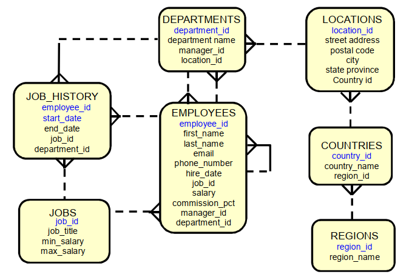 -->

<div class="hr-table-wrapper">
  <table class="hr-table">
    <thead>
      <tr>
        <th>Tabla</th>
        <th>Atributos principales</th>
        <th>Llave primaria</th>
        <th>Llaves foráneas</th>
        <th>Filas</th>
      </tr>
    </thead>
    <tbody>
      <tr>
        <td>REGIONS</td>
        <td>region_id, region_name</td>
        <td>region_id</td>
        <td>—</td>
        <td>4</td>
      </tr>
      <tr>
        <td>COUNTRIES</td>
        <td>country_id, country_name, region_id</td>
        <td>country_id</td>
        <td>region_id → REGIONS</td>
        <td>25</td>
      </tr>
      <tr>
        <td>LOCATIONS</td>
        <td>location_id, street_address, postal_code, city, state_province, country_id</td>
        <td>location_id</td>
        <td>country_id → COUNTRIES</td>
        <td>23</td>
      </tr>
      <tr>
        <td>DEPARTMENTS</td>
        <td>department_id, department_name, manager_id, location_id</td>
        <td>department_id</td>
        <td>location_id → LOCATIONS, manager_id → EMPLOYEES</td>
        <td>27</td>
      </tr>
      <tr>
        <td>JOBS</td>
        <td>job_id, job_title, min_salary, max_salary</td>
        <td>job_id</td>
        <td>—</td>
        <td>19</td>
      </tr>
      <tr>
        <td>EMPLOYEES</td>
        <td>employee_id, first_name, last_name, email, phone_number, hire_date, job_id, salary, commission_pct, manager_id, department_id</td>
        <td>employee_id</td>
        <td>job_id → JOBS, department_id → DEPARTMENTS, manager_id → EMPLOYEES</td>
        <td>107</td>
      </tr>
      <tr>
        <td>JOB_HISTORY</td>
        <td>employee_id, start_date, end_date, job_id, department_id</td>
        <td>(employee_id, start_date)</td>
        <td>employee_id → EMPLOYEES, job_id → JOBS, department_id → DEPARTMENTS</td>
        <td>10</td>
      </tr>
    </tbody>
  </table>
</div>


> **Nota sobre el orden de los datos:** Los ejercicios que no tienen `ORDER BY` no siguen un orden en particular. Sin `ORDER BY`, Oracle no garantiza ningún orden en el resultado, así que las mismas filas pueden aparecer en otra posición. Si el orden importa, siempre debe pedirse explícitamente.
Además en cada ejercicio se muestran las **por lo general las primeras 20 filas** del resultado de lo contario solo el numero de filas resultantes de la consulta.


---

## 1. SELECT básico

`SELECT` recupera columnas de una o varias tablas. Con `DISTINCT` se eliminan filas repetidas y con alias (`AS`) se renombran las columnas del resultado. En Oracle, `||` concatena texto.

### Ejercicio S1-1

**Enunciado:** Mostrar el nombre completo (nombre y apellido en una sola columna) y el correo de todos los empleados.

```sql
SELECT first_name || ' ' || last_name AS nombre_completo,
       email
FROM employees;
```


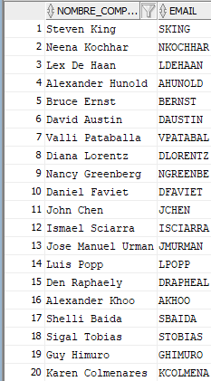 

### Ejercicio S1-2

**Enunciado:** Listar los cargos (`job_id`) que desempeñan actualmente los empleados, sin repetir.

```sql
SELECT DISTINCT job_id
FROM employees;
```


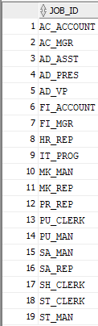

## 2. Restricting and Sorting Data

`WHERE` filtra filas con operadores de comparación, `AND`, `OR`, `NOT`, `IN`, `BETWEEN`, `LIKE` e `IS NULL`. `ORDER BY` las ordena de forma ascendente (`ASC`) o descendente (`DESC`).

### Ejercicio S2-1

**Enunciado:** Mostrar el nombre, apellido y salario de los empleados del departamento 50 que ganan entre 3000 y 5000, del mayor al menor salario.

```sql
SELECT first_name, last_name, salary
FROM employees
WHERE department_id = 50
  AND salary BETWEEN 3000 AND 5000
ORDER BY salary DESC;
```


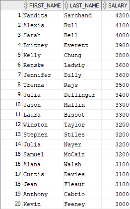

### Ejercicio S2-2

**Enunciado:** Mostrar el apellido de los empleados que no tienen departamento asignado o cuyo apellido empieza por la letra K, ordenados alfabéticamente.

```sql
SELECT last_name, department_id
FROM employees
WHERE department_id IS NULL
   OR last_name LIKE 'K%'
ORDER BY last_name;
```


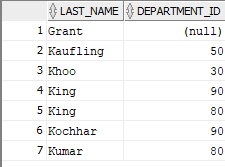

## 3. Single-Row Functions

Son funciones que se aplican a cada fila y devuelven un valor por fila. Hay de texto (`UPPER`, `SUBSTR`, `LENGTH`), numéricas (`ROUND`, `TRUNC`, `MOD`), de fecha (`SYSDATE`, `MONTHS_BETWEEN`, `ADD_MONTHS`) y de conversión y nulos (`TO_CHAR`, `TO_DATE`, `NVL`).

### Ejercicio S3-1

**Enunciado:** Mostrar el apellido en mayúsculas, la cantidad de letras del apellido y el nombre abreviado (inicial y apellido) de cada empleado.

```sql
SELECT UPPER(last_name)                     AS apellido,
       LENGTH(last_name)                    AS letras,
       SUBSTR(first_name, 1, 1) || '. ' || last_name AS abreviado
FROM employees;
```


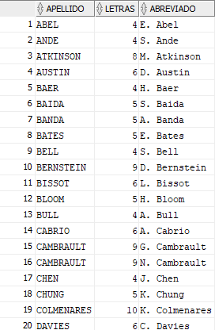

### Ejercicio S3-2

**Enunciado:** Mostrar para cada empleado la fecha de ingreso con formato `DD-MM-YYYY`, los años completos que lleva en la empresa y su ingreso total (salario más comisión; si no tiene comisión se toma como 0), ordenado del más antiguo al más reciente.

```sql
SELECT first_name,
       last_name,
       TO_CHAR(hire_date, 'DD-MM-YYYY')                 AS fecha_ingreso,
       TRUNC(MONTHS_BETWEEN(SYSDATE, hire_date) / 12)   AS anios,
       salary + salary * NVL(commission_pct, 0)         AS ingreso_total
FROM employees
ORDER BY hire_date;
```


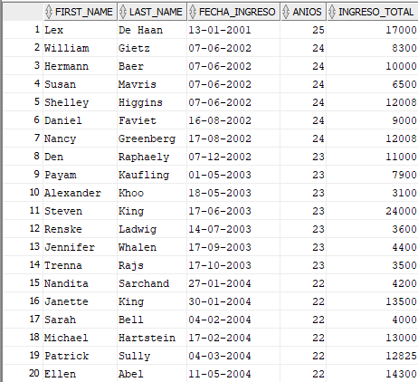

## 4. Aggregate Data Group Functions

Operan sobre un conjunto de filas y devuelven un solo valor: `COUNT`, `SUM`, `AVG`, `MIN`, `MAX`. Con `GROUP BY` se calculan por grupo y con `HAVING` se filtran los grupos.

### Ejercicio S4-1

**Enunciado:** Obtener el salario mínimo, el máximo, el promedio, la suma total de la nómina y la cantidad de empleados.

```sql
SELECT MIN(salary)            AS salario_min,
       MAX(salary)            AS salario_max,
       ROUND(AVG(salary), 2)  AS salario_prom,
       SUM(salary)            AS nomina_total,
       COUNT(*)               AS empleados
FROM employees;
```


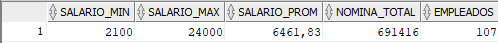 

### Ejercicio S4-2

**Enunciado:** Mostrar, por departamento, la cantidad de empleados y el salario promedio, solo para los departamentos con más de 5 empleados, del que tiene más empleados al que tiene menos.

```sql
SELECT department_id,
       COUNT(*)              AS cant_empleados,
       ROUND(AVG(salary), 2) AS salario_prom
FROM employees
GROUP BY department_id
HAVING COUNT(*) > 5
ORDER BY cant_empleados DESC;
```


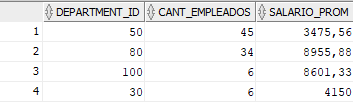 

## 5. Joins (SQL_C7)

Un `JOIN` combina filas de dos o más tablas usando una condición. Los tipos son `INNER JOIN`, `LEFT`, `RIGHT` y `FULL OUTER JOIN`, `CROSS JOIN` y `NATURAL JOIN`. Un self join une una tabla consigo misma, por ejemplo `employees` con su `manager_id`.

### Tipos de join

- **`INNER JOIN`:** devuelve solo las filas que tienen pareja en **ambas** tablas. Las filas sin coincidencia se descartan. Es el join por defecto: si escribes solo `JOIN`, Oracle lo trata como `INNER JOIN`.
- **`LEFT JOIN` (`LEFT OUTER JOIN`):** devuelve **todas** las filas de la tabla de la izquierda, tengan o no pareja en la derecha. Donde no hay coincidencia, las columnas de la tabla derecha salen en `NULL`.
- **`RIGHT JOIN` (`RIGHT OUTER JOIN`):** es lo contrario del anterior: devuelve **todas** las filas de la tabla de la derecha y, si no hay pareja en la izquierda, completa con `NULL`.
- **`FULL JOIN` (`FULL OUTER JOIN`):** devuelve **todas** las filas de ambas tablas. Las que no tienen pareja aparecen con `NULL` en las columnas del otro lado.

Un ejemplo en el esquema HR: con `INNER JOIN` entre `employees` y `departments` no aparece el empleado que no tiene departamento, porque no hay coincidencia. Con `LEFT JOIN` desde `employees` sí aparece, con las columnas del departamento en `NULL`.
### Ejercicio S5-1

**Enunciado:** Mostrar el nombre y apellido de cada empleado con el nombre de su departamento y la ciudad donde está ubicado.

```sql
SELECT e.first_name, e.last_name, d.department_name, l.city
FROM employees e
JOIN departments d ON e.department_id = d.department_id
JOIN locations l   ON d.location_id = l.location_id;
```


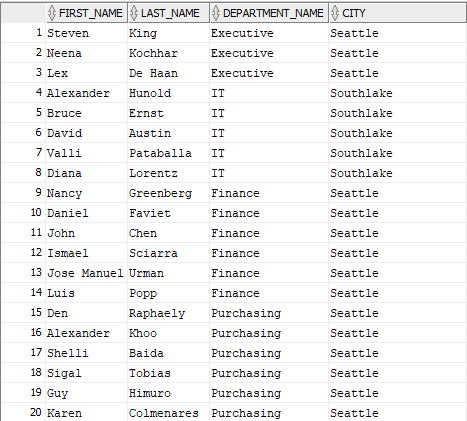 

### Ejercicio S5-2

**Enunciado:** Mostrar el apellido de cada empleado y el de su jefe. Quien no tiene jefe debe aparecer igual con el texto `Sin jefe`.

```sql
SELECT e.last_name                 AS empleado,
       NVL(m.last_name, 'Sin jefe') AS jefe
FROM employees e
LEFT JOIN employees m ON e.manager_id = m.employee_id
ORDER BY e.employee_id;
```


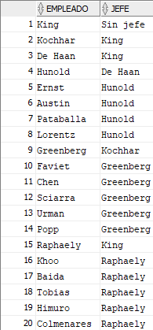

## 6. Subqueries

Una subconsulta es una consulta dentro de otra. Puede devolver un valor (`=`, `>`), varios (`IN`, `ANY`, `ALL`) o comprobar existencia (`EXISTS`). Puede ir en `WHERE`, `FROM` o `SELECT`.

### Ejercicio S6-1

**Enunciado:** Mostrar el nombre, apellido y salario de los empleados que ganan más que el salario promedio de toda la empresa.

```sql
SELECT first_name, last_name, salary
FROM employees
WHERE salary > (SELECT AVG(salary) FROM employees)
ORDER BY salary DESC;
```


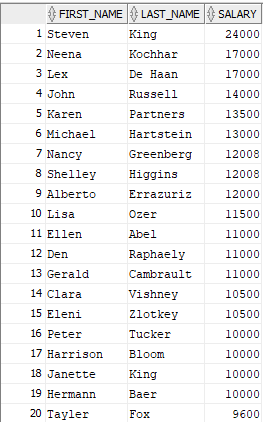 
### Ejercicio S6-2

**Enunciado:** Mostrar el nombre, apellido y departamento de los empleados que trabajan en departamentos ubicados en la ciudad de Seattle.

```sql
SELECT first_name, last_name, department_id
FROM employees
WHERE department_id IN (
  SELECT department_id
  FROM departments
  WHERE location_id IN (
    SELECT location_id
    FROM locations
    WHERE city = 'Seattle'
  )
);
```


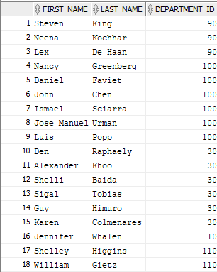 

## 7. Set Operators

Combinan los resultados de dos consultas que tienen las mismas columnas: `UNION` (sin repetidos), `UNION ALL` (con repetidos), `INTERSECT` y `MINUS`.

### Ejercicio S7-1 — UNION

**Enunciado:** Obtener la lista única de cargos que aparecen en la tabla de empleados o en el historial de cargos.

```sql
SELECT job_id FROM employees
UNION
SELECT job_id FROM job_history;
```


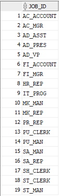 

### Ejercicio S7-2 — INTERSECT

**Enunciado:** Obtener los cargos que hoy desempeña algún empleado y que además aparecen en el historial de cargos.

```sql
SELECT job_id FROM employees
INTERSECT
SELECT job_id FROM job_history;
```


### Ejercicio S7-3 — MINUS

**Enunciado:** Obtener los departamentos que tienen empleados pero que nunca aparecen en el historial de cargos.

```sql
SELECT department_id FROM employees
WHERE department_id IS NOT NULL
MINUS
SELECT department_id FROM job_history;
```


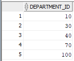 

---

## Conclusión

Con el esquema HR se practicó el recorrido completo de SQL en Oracle: desde consultas simples con filtros y funciones hasta joins de varias tablas, subconsultas anidadas y operadores de conjuntos. Los operadores `UNION`, `INTERSECT` y `MINUS` son el equivalente directo de la unión, la intersección y la diferencia del álgebra relacional vista en la primera parte.

## ¡Intenta recrear tus propias consultas!

¿Quieres practicar lo mismo que se hizo en este ejercicio? Descarga los dos scripts adjuntados, ejecútalos en tu Oracle y empieza a escribir tus propias consultas sobre el esquema HR.

- **DDL (Data Definition Language):** crea la estructura de la base de datos: las 7 tablas, sus llaves primarias y foráneas, las restricciones (`NOT NULL`, `UNIQUE`, `CHECK`), las secuencias y los índices. Se ejecuta primero.
- **DML (Data Manipulation Language):** inserta los datos de ejemplo: 215 filas repartidas entre las 7 tablas, y termina con un `COMMIT`. Se ejecuta después del DDL.

<div class="download-box">
  <p class="download-box__title">Scripts del esquema HR</p>
  <div class="download-box__buttons">
    <a class="download-btn" href="/descargas/hr_ddl.sql" download>↓ Descargar DDL · hr_ddl.sql</a>
    <a class="download-btn" href="/descargas/hr_dml.sql" download>↓ Descargar DML · hr_dml.sql</a>
  </div>
</div>

**Cómo usarlos en Oracle SQL Developer**

1. Conéctate a tu base de datos desde SQL Developer.
2. Abre `hr_ddl.sql` (Archivo → Abrir) y ejecútalo como **script** con **F5**.
3. Abre `hr_dml.sql` y ejecútalo también con **F5**.
4. Comprueba que todo quedó creado:

```sql
SELECT table_name FROM user_tables ORDER BY table_name;
```
