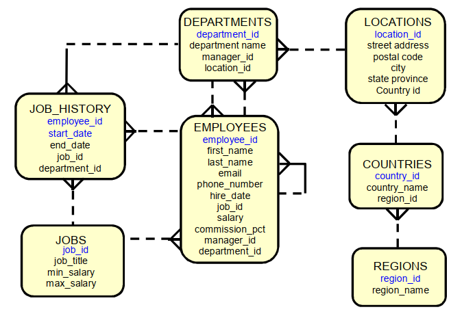
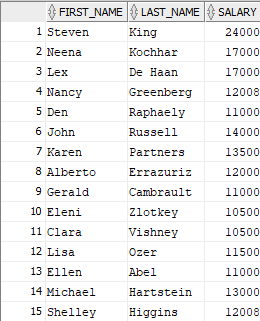
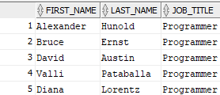
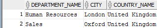
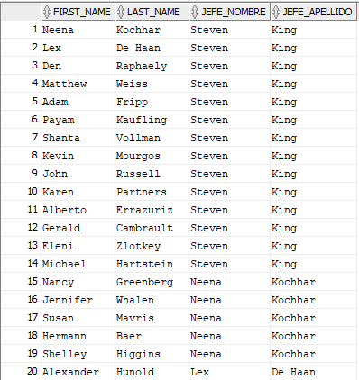
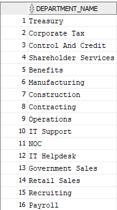
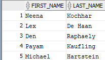
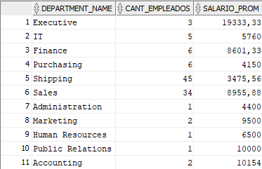
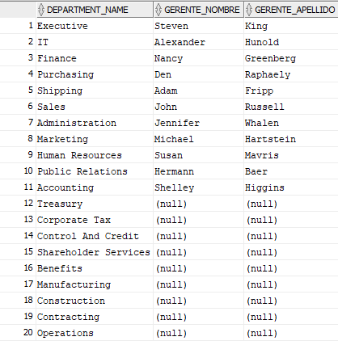
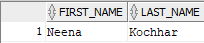

[En esta actividad se trabajó con el esquema **HR (Human Resources) de Oracle**, una base de datos de ejemplo ampliamente utilizada para aprender y practicar SQL. El esquema representa la información de recursos humanos de una empresa mediante tablas relacionadas, como empleados, departamentos, cargos y ubicaciones.

A partir de su diagrama entidad-relación, se identificaron las tablas, sus atributos, llaves primarias y llaves foráneas. Este modelo se utilizó como referencia para desarrollar ejercicios de **álgebra relacional y SQL**, explorando cómo expresar operaciones relacionales y traducirlas en consultas sobre una base de datos real.]

## ¿Qué es Oracle?

Oracle Database es un sistema gestor de bases de datos relacionales (SGBD) de Oracle Corporation. Guarda la información en tablas relacionadas por llaves y se consulta con SQL (en su variante propia) y PL/SQL.

## ¿Qué es SQL Developer?

Oracle SQL Developer es un entorno gráfico gratuito de Oracle. Permite conectarse a la base de datos, explorar tablas, escribir y ejecutar consultas SQL y PL/SQL, y ver los resultados en una cuadrícula. Un script completo se ejecuta con **F5** y una sola sentencia con **Ctrl + Enter**.

## Esquema de trabajo: HR

El esquema modela los recursos humanos de una empresa y tiene **7 tablas**.

<!--  -->


<div class="hr-table-wrapper">
  <table class="hr-table">
    <thead>
      <tr>
        <th>Tabla</th>
        <th>Atributos principales</th>
        <th>Llave primaria</th>
        <th>Llaves foráneas</th>
        <th>Filas</th>
      </tr>
    </thead>
    <tbody>
      <tr>
        <td>REGIONS</td>
        <td>region_id, region_name</td>
        <td>region_id</td>
        <td>—</td>
        <td>4</td>
      </tr>
      <tr>
        <td>COUNTRIES</td>
        <td>country_id, country_name, region_id</td>
        <td>country_id</td>
        <td>region_id → REGIONS</td>
        <td>25</td>
      </tr>
      <tr>
        <td>LOCATIONS</td>
        <td>location_id, street_address, postal_code, city, state_province, country_id</td>
        <td>location_id</td>
        <td>country_id → COUNTRIES</td>
        <td>23</td>
      </tr>
      <tr>
        <td>DEPARTMENTS</td>
        <td>department_id, department_name, manager_id, location_id</td>
        <td>department_id</td>
        <td>location_id → LOCATIONS, manager_id → EMPLOYEES</td>
        <td>27</td>
      </tr>
      <tr>
        <td>JOBS</td>
        <td>job_id, job_title, min_salary, max_salary</td>
        <td>job_id</td>
        <td>—</td>
        <td>19</td>
      </tr>
      <tr>
        <td>EMPLOYEES</td>
        <td>employee_id, first_name, last_name, email, phone_number, hire_date, job_id, salary, commission_pct, manager_id, department_id</td>
        <td>employee_id</td>
        <td>job_id → JOBS, department_id → DEPARTMENTS, manager_id → EMPLOYEES</td>
        <td>107</td>
      </tr>
      <tr>
        <td>JOB_HISTORY</td>
        <td>employee_id, start_date, end_date, job_id, department_id</td>
        <td>(employee_id, start_date)</td>
        <td>employee_id → EMPLOYEES, job_id → JOBS, department_id → DEPARTMENTS</td>
        <td>10</td>
      </tr>
    </tbody>
  </table>
</div>


**Relaciones destacadas**

- REGIONS 1—N COUNTRIES 1—N LOCATIONS 1—N DEPARTMENTS 1—N EMPLOYEES.
- JOBS 1—N EMPLOYEES y JOBS 1—N JOB_HISTORY.
- EMPLOYEES 1—N EMPLOYEES (`manager_id`): relación recursiva, cada empleado tiene un jefe.
- DEPARTMENTS ↔ EMPLOYEES (`manager_id`): relación circular, un departamento tiene un empleado como gerente.
- JOB_HISTORY tiene llave primaria compuesta (`employee_id`, `start_date`).

## Creación de la base de datos

Se ejecutaron dos scripts en SQL Developer con **F5**: primero el DDL (tablas, llaves, secuencias e índices) y después el DML (los `INSERT` y un `COMMIT` al final).


<!--  -->

---

# Parte 1 — Álgebra relacional

## ¿Qué es el álgebra relacional?

Es un lenguaje formal con operaciones que reciben tablas (relaciones) y devuelven otra tabla. Es la base teórica de SQL: cada `SELECT`, `WHERE` y `JOIN` tiene su equivalente en álgebra relacional.

## Operadores


<div class="hr-table-wrapper">
  <table class="algebra-table">
    <thead>
      <tr>
        <th>Operación</th>
        <th>Símbolo</th>
        <th>¿Qué hace?</th>
        <th>Equivalente en SQL</th>
      </tr>
    </thead>
    <tbody>
      <tr>
        <td>Selección</td>
        <td>σ</td>
        <td>Filtra filas por una condición</td>
        <td><code>WHERE</code></td>
      </tr>
      <tr>
        <td>Proyección</td>
        <td>π</td>
        <td>Elige columnas</td>
        <td><code>SELECT col1, col2</code></td>
      </tr>
      <tr>
        <td>Renombrar</td>
        <td>ρ</td>
        <td>Cambia el nombre de tablas o columnas</td>
        <td><code>AS</code></td>
      </tr>
      <tr>
        <td>Unión</td>
        <td>∪</td>
        <td>Junta filas de dos tablas sin repetir</td>
        <td><code>UNION</code></td>
      </tr>
      <tr>
        <td>Intersección</td>
        <td>∩</td>
        <td>Filas comunes a ambas tablas</td>
        <td><code>INTERSECT</code></td>
      </tr>
      <tr>
        <td>Diferencia</td>
        <td>−</td>
        <td>Filas de A que no están en B</td>
        <td><code>MINUS</code></td>
      </tr>
      <tr>
        <td>Producto cartesiano</td>
        <td>×</td>
        <td>Todas las combinaciones de filas</td>
        <td><code>CROSS JOIN</code></td>
      </tr>
      <tr>
        <td>Join natural</td>
        <td>⋈</td>
        <td>Une tablas por columnas iguales</td>
        <td><code>NATURAL JOIN</code> / <code>JOIN ... ON</code></td>
      </tr>
      <tr>
        <td>Outer join</td>
        <td>⟕ ⟖ ⟗</td>
        <td>Join que conserva filas sin pareja</td>
        <td><code>LEFT/RIGHT/FULL OUTER JOIN</code></td>
      </tr>
      <tr>
        <td>División</td>
        <td>÷</td>
        <td>¿Quién tiene TODOS los...?</td>
        <td><code>GROUP BY</code> + <code>HAVING</code></td>
      </tr>
      <tr>
        <td>Agregación</td>
        <td>G ℑ</td>
        <td>Agrupa y calcula (SUM, COUNT, AVG...)</td>
        <td><code>GROUP BY</code></td>
      </tr>
    </tbody>
  </table>
</div>


> En Oracle la diferencia se escribe `MINUS`, no `EXCEPT`.

## Notación usada

En los joins uso la condición explícita (theta join, `⋈ condición`) en vez del join natural. En HR, `EMPLOYEES` y `DEPARTMENTS` comparten dos columnas, `department_id` y `manager_id`, y un join natural las uniría por las dos y daría un resultado incorrecto.

> **Nota sobre el orden de los datos:** Los ejercicios que no tienen `ORDER BY` no siguen un orden en particular. Sin `ORDER BY`, Oracle no garantiza ningún orden en el resultado, así que las mismas filas pueden aparecer en otra posición. Si el orden importa, siempre debe pedirse explícitamente.
Además en cada ejercicio se muestran las **por lo general las primeras 20 filas** del resultado de lo contario solo el numero de filas resultantes de la consulta.

## Ejercicio AR-1 — Selección y proyección

**Enunciado:** Obtener el nombre, el apellido y el salario de los empleados que ganan más de 10000.

**Expresión en álgebra relacional:**

```
π first_name, last_name, salary ( σ salary > 10000 ( EMPLOYEES ) )
```

**Traducción a SQL:**

```sql
SELECT first_name, last_name, salary
FROM employees
WHERE salary > 10000;
```

 

## Ejercicio AR-2 — Join de tres tablas

**Enunciado:** Obtener el nombre, el apellido y el cargo (`job_title`) de los empleados que trabajan en el departamento `IT`.

**Expresión en álgebra relacional:**

```
π first_name, last_name, job_title (
  σ department_name = 'IT' (
    ( EMPLOYEES ⋈ EMPLOYEES.department_id = DEPARTMENTS.department_id DEPARTMENTS )
                ⋈ EMPLOYEES.job_id = JOBS.job_id JOBS
  )
)
```

**Traducción a SQL:**

```sql
SELECT e.first_name, e.last_name, j.job_title
FROM employees e
JOIN departments d ON e.department_id = d.department_id
JOIN jobs j        ON e.job_id = j.job_id
WHERE d.department_name = 'IT';
```




## Ejercicio AR-3 — Cadena de joins (departamento → ubicación → país)

**Enunciado:** Obtener el nombre del departamento, la ciudad y el país de los departamentos ubicados en el Reino Unido (`United Kingdom`).

**Expresión en álgebra relacional:**

```
π department_name, city, country_name (
  σ country_name = 'United Kingdom' (
    DEPARTMENTS ⋈ LOCATIONS ⋈ COUNTRIES
  )
)
```

**Traducción a SQL:**

```sql
SELECT d.department_name, l.city, c.country_name
FROM departments d
JOIN locations l ON d.location_id = l.location_id
JOIN countries c ON l.country_id = c.country_id
WHERE c.country_name = 'United Kingdom';
```




## Ejercicio AR-4 — Renombrar (self join)

**Enunciado:** Obtener el nombre y apellido de cada empleado junto con el nombre y apellido de su jefe.

**Expresión en álgebra relacional:**

```
JEFE = ρ JEFE(jefe_id, jefe_nombre, jefe_apellido) ( π employee_id, first_name, last_name ( EMPLOYEES ) )
π first_name, last_name, jefe_nombre, jefe_apellido (
  EMPLOYEES ⋈ EMPLOYEES.manager_id = JEFE.jefe_id JEFE
)
```

**Traducción a SQL:**

```sql
SELECT e.first_name, e.last_name,
       j.first_name AS jefe_nombre,
       j.last_name  AS jefe_apellido
FROM employees e
JOIN employees j ON e.manager_id = j.employee_id;
```


 

## Ejercicio AR-5 — Diferencia

**Enunciado:** Obtener el nombre de los departamentos que no tienen ningún empleado.

**Expresión en álgebra relacional:**

```
TODOS    = π department_id ( DEPARTMENTS )
CON_EMP  = π department_id ( EMPLOYEES )
SIN_EMP  = TODOS − CON_EMP
π department_name ( DEPARTMENTS ⋈ SIN_EMP )
```

**Traducción a SQL:**

```sql
SELECT department_name
FROM departments
WHERE department_id IN (
  SELECT department_id FROM departments
  MINUS
  SELECT department_id FROM employees
);
```


 

## Ejercicio AR-6 — Intersección

**Enunciado:** Obtener el nombre y apellido de los empleados que tienen historial de cargos (`JOB_HISTORY`) y que además son jefes de alguien.

**Expresión en álgebra relacional:**

```
CON_HISTORIAL = π employee_id ( JOB_HISTORY )
SON_JEFES     = ρ SON_JEFES(employee_id) ( π manager_id ( EMPLOYEES ) )
RESULTADO = CON_HISTORIAL ∩ SON_JEFES
π first_name, last_name ( EMPLOYEES ⋈ RESULTADO )
```

**Traducción a SQL:**

```sql
SELECT first_name, last_name
FROM employees
WHERE employee_id IN (
  SELECT employee_id FROM job_history
  INTERSECT
  SELECT manager_id  FROM employees
);
```

**Resultado (primeras 10 filas):**

<!--  -->

## Ejercicio AR-7 — Agregación + join

**Enunciado:** Obtener el nombre de cada departamento con su cantidad de empleados y su salario promedio.

**Expresión en álgebra relacional:**

```
RESUMEN = G department_id ℑ COUNT(employee_id) AS cant_empleados, AVG(salary) AS salario_prom ( EMPLOYEES )
π department_name, cant_empleados, salario_prom (
  DEPARTMENTS ⋈ RESUMEN
)
```

**Traducción a SQL:**

```sql
SELECT d.department_name,
       COUNT(e.employee_id) AS cant_empleados,
       ROUND(AVG(e.salary), 2) AS salario_prom
FROM departments d
JOIN employees e ON d.department_id = e.department_id
GROUP BY d.department_name;
```


 -->

## Ejercicio AR-8 — Left outer join

**Enunciado:** Listar todos los departamentos con el nombre de su gerente. Los departamentos sin gerente deben aparecer igual, con valores nulos.

**Expresión en álgebra relacional:**

```
GERENTE = ρ GERENTE(gerente_id, gerente_nombre, gerente_apellido) ( π employee_id, first_name, last_name ( EMPLOYEES ) )
π department_name, gerente_nombre, gerente_apellido (
  DEPARTMENTS ⟕ DEPARTMENTS.manager_id = GERENTE.gerente_id GERENTE
)
```

**Traducción a SQL:**

```sql
SELECT d.department_name,
       e.first_name AS gerente_nombre,
       e.last_name  AS gerente_apellido
FROM departments d
LEFT JOIN employees e ON d.manager_id = e.employee_id;
```


 

## Ejercicio AR-9 — División

**Enunciado:** Obtener el nombre y apellido de los empleados que, en su historial de cargos, han ocupado **todos** los cargos `AC_ACCOUNT` y `AC_MGR`.

**Expresión en álgebra relacional:**

```
CARGOS   = { AC_ACCOUNT, AC_MGR }
HISTORIAL = π employee_id, job_id ( JOB_HISTORY )
RESULTADO = HISTORIAL ÷ CARGOS
π first_name, last_name ( EMPLOYEES ⋈ RESULTADO )
```

**Traducción a SQL:**

```sql
SELECT e.first_name, e.last_name
FROM employees e
WHERE e.employee_id IN (
  SELECT employee_id
  FROM job_history
  WHERE job_id IN ('AC_ACCOUNT', 'AC_MGR')
  GROUP BY employee_id
  HAVING COUNT(DISTINCT job_id) = 2
);
```


  
---


