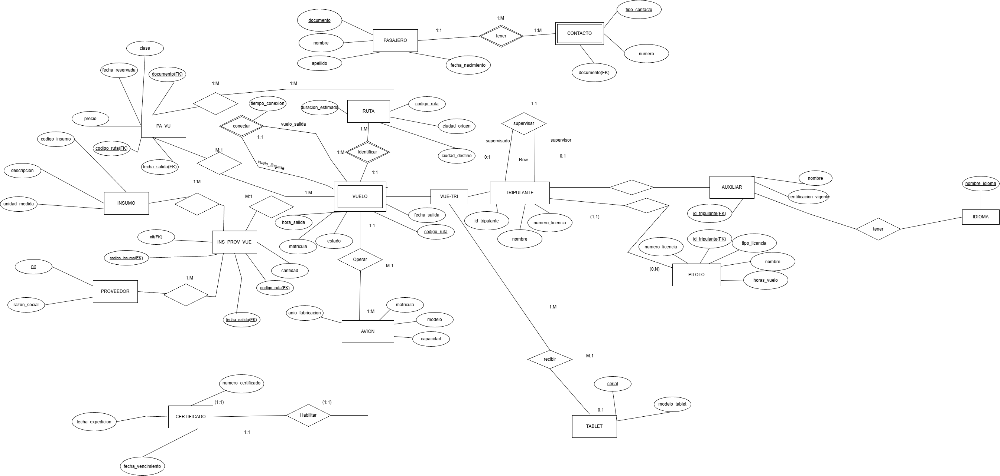

Este fue el Taller 1 de Bases de Datos 1, realizado en grupo. A partir de un modelo conceptual ya validado de una aerolínea, **AeroAndes**, el trabajo consistió en transformarlo aplicando las reglas vistas en clase y justificar cada una. El modelo se elaboró en draw.io; el enlace de entrega está en la sección de resultado.

## Instrucciones

En este taller el resultado de cada punto es un modelo entidad–relación transformado, dibujado en notación de Peter Chen: todo modelo que entregue debe mostrar entidades, relaciones, atributos, cardinalidades y participaciones. Cada transformación debe ir acompañada de la justificación de la regla aplicada; una transformación correcta sin justificación obtiene la mitad del puntaje. Los modelos deben elaborarse en draw.io y adjuntarse el enlace de cada uno en la entrega; el enlace debe permitir el acceso del docente. La fecha y hora de última modificación de cada archivo no puede ser posterior a la hora de finalización del taller, que se entrega al terminar la clase; todo modelo cuya última modificación sea posterior a esa hora no será calificado.

## Modelo de partida — Aerolínea AeroAndes

El siguiente modelo conceptual fue validado con el área funcional y está expresado en notación de Peter Chen. El modelo es correcto: su tarea no es rediseñarlo ni corregirlo, sino transformarlo.

**Entidades y atributos**

```
PASAJERO (documento, nombre_completo, fecha_nacimiento, contacto, correo)
    nombre_completo es compuesto: nombres, apellidos
    contacto es multivaluado y compuesto: tipo_contacto, numero
    edad es derivado de fecha_nacimiento
RUTA (codigo_ruta, ciudad_origen, ciudad_destino, duracion_estimada)
VUELO (fecha_salida, hora_salida, estado)
    entidad débil dependiente en identificación de RUTA; fecha_salida es su clave parcial
AVION (matricula, modelo, capacidad, anio_fabricacion)
    antiguedad es derivado de anio_fabricacion
CERTIFICADO (numero_certificado, fecha_expedicion, fecha_vencimiento)
TRIPULANTE (id_tripulante, nombre, numero_licencia)
INSUMO (codigo_insumo, descripcion, unidad_medida)
PROVEEDOR (nit, razon_social)
TABLET (serial, modelo_tablet)
```

**Qué representa cada entidad.** PASAJERO: la persona que vuela. RUTA: el trayecto comercial (por ejemplo BOG–MDE), independiente del día. VUELO: la ocurrencia concreta de una ruta en una fecha. AVION: la aeronave física, identificada por su matrícula. CERTIFICADO: el certificado de aeronavegabilidad vigente del avión. TRIPULANTE: miembro de la tripulación, piloto o auxiliar. INSUMO: artículo que se consume a bordo (mantas, audífonos, bebidas). PROVEEDOR: empresa que entrega los insumos. TABLET: dispositivo del inventario que la aerolínea presta al tripulante durante el vuelo.

**Relaciones**

```
1. IDENTIFICA  RUTA (1) —— (N) VUELO · relación identificadora · VUELO: total
2. OPERA       AVION (1) —— (N) VUELO · VUELO: total · AVION: parcial
3. HABILITA    AVION (1) —— (1) CERTIFICADO · ambos: participación total
4. RESERVA     PASAJERO (M) —— (N) VUELO
               atributos de la relación: clase, precio, fecha_reserva
5. ASIGNA      TRIPULANTE (M) —— (N) VUELO
               atributos de la relación: rol_a_bordo, horas_servicio
6. SUPERVISA   TRIPULANTE (1) —— (N) TRIPULANTE · recursiva
               roles: supervisor / supervisado · participación parcial en ambos extremos
7. CONECTA     VUELO (M) —— (N) VUELO · recursiva
               roles: vuelo_llegada / vuelo_salida · atributo de la relación: tiempo_conexion
8. SUMINISTRA  ternaria PROVEEDOR —— VUELO —— INSUMO · atributo: cantidad
               para un vuelo y un insumo dados existe un único proveedor (M : N : 1)
9. DOTA        agregación: la participación de un TRIPULANTE en un VUELO
               (relación ASIGNA) recibe a lo sumo una TABLET; una misma tablet puede
               asignarse a muchas participaciones a lo largo del tiempo (N) —— (1) TABLET
10. ESPECIALIZACIÓN  TRIPULANTE → PILOTO (horas_vuelo, tipo_licencia)
                     TRIPULANTE → AUXILIAR (idiomas, certificacion_vigente)
                     idiomas es multivaluado · jerarquía TOTAL y DISJUNTA
```

## Enunciado de los ejercicios

### Ejercicio 1 — Transformación de atributos

Ningún atributo compuesto, multivaluado o derivado puede sobrevivir en el modelo transformado.

**Se pide:**

**a.** Transforme los atributos de PASAJERO. Dibuje el fragmento del modelo resultante indicando, para cada relación nueva, su cardinalidad y su participación. Señale si alguna de las entidades que aparecen es débil y cuál sería su atributo clave.

**b.** El atributo contacto es multivaluado y compuesto al mismo tiempo. Explique en qué orden aplicó las reglas y por qué el modelo resultante no es equivalente si se aplican en el orden contrario.

**c.** Explique por qué edad y antiguedad desaparecen del modelo transformado, y qué información conserva el modelo pese a su eliminación.

**d.** Suponga que la aerolínea decide que un pasajero registrará como máximo dos contactos. Discuta si la regla de transformación del atributo multivaluado cambia y qué consecuencia tiene cada alternativa sobre el modelo.

### Ejercicio 2 — Transformación de relaciones N:M con atributos

**Se pide:**

**a.** Transforme la relación RESERVA. Dibuje el fragmento resultante con la entidad que surge de la transformación, sus atributos y las relaciones que la conectan con PASAJERO y con VUELO, indicando cardinalidad y participación en cada extremo. Indique si esa entidad es débil, de qué entidades depende en identificación y cuál es su atributo clave.

**b.** Transforme la relación ASIGNA aplicando la misma regla. Explique por qué rol_a_bordo y horas_servicio no pueden colocarse como atributos de TRIPULANTE ni de VUELO, y dé un ejemplo concreto de dato que se perdería o se duplicaría si se hiciera así.

**c.** Explique por qué esta transformación conserva la semántica original del modelo, mientras que sustituir la relación N:M por dos relaciones 1:N directas entre PASAJERO y VUELO sí la alteraría.

### Ejercicio 3 — Relación ternaria y agregación

**Se pide:**

**a.** Transforme la relación ternaria SUMINISTRA. Dibuje el fragmento resultante con la entidad que la reemplaza y las tres relaciones binarias que aparecen, indicando cardinalidad y participación de cada una, y la ubicación del atributo cantidad. Explique además cómo queda representada en el modelo transformado la restricción “para un vuelo y un insumo dados existe un único proveedor”.

**b.** Transforme la agregación DOTA. Explique por qué la relación con TABLET no puede dibujarse directamente contra TRIPULANTE ni contra VUELO, y muestre sobre qué elemento del modelo ya transformado queda apoyada. Indique cardinalidad y participación.

### Ejercicio 4 — Especialización y relaciones recursivas

**Se pide:**

**a.** Transforme la jerarquía de especialización de TRIPULANTE. Dibuje el fragmento resultante, indique la cardinalidad y la participación de las relaciones que aparecen, explique cómo se refleja en el modelo transformado que la jerarquía es total y disjunta, y muestre qué ocurre con el atributo idiomas.

**b.** Analice las dos relaciones recursivas del modelo, SUPERVISA y CONECTA. Indique cuál de las dos exige transformación y cuál no, justifique la diferencia, transforme la que corresponda conservando los nombres de rol y señale dónde queda el atributo tiempo_conexion.

**c.** Enumere las relaciones del modelo de partida que no requieren ninguna transformación y justifique en una línea por qué pueden pasar tal como están al modelo relacional.

### Ejercicio 5 — Análisis crítico de un modelo transformado

Un estudiante entrega el siguiente modelo transformado del mismo modelo. Se describe en texto:

```
PASAJERO (documento, nombres, apellidos, contacto1, contacto2, edad, correo)
RESERVA (id_reserva, clase, precio, fecha_reserva, fecha_salida)
    relación: PASAJERO (1) —— (N) RESERVA (RESERVA no se conecta con VUELO)
OPERACION (id_operacion)
    relaciones: AVION (1) —— (N) OPERACION —— (1) VUELO
TRIPULANTE (id_tripulante, nombre, numero_licencia, horas_vuelo, tipo_licencia, idiomas)
```

Identifique tres errores. Para cada uno indique qué regla de transformación se violó, qué consecuencia tiene sobre el modelo y cómo debe corregirse el modelo.

## Mi modelo transformado



El modelo está elaborado en draw.io y se puede ver aquí: [Enlace al modelo en draw.io](https://drive.google.com/file/d/1ig0aleHb2NvOSvYzBUbSlfNp_rRXZrgY/view?usp=drivesdk).

## Respuestas

### Ejercicio 1 — Transformación de atributos

**a.** Sí aparece una entidad débil y es CONTACTO, esta ni tiene atributo clave propio independiente, porque ni numero ni tipo_contacto identifican una fila de forma única; tampoco tiene existencia propia, ya que un contacto solo tiene sentido como propiedad de un pasajero específico y desaparece si el pasajero desaparece. Por eso depende de PASAJERO y su atributo clave es la combinación documento (FK) + tipo_contacto como discriminador parcial Esta misma lógica es la que usamos con VUELO, que toma codigo_ruta (FK) de RUTA y agrega fecha_salida como clave parcial.

**b.** El atributo contacto al ser multivaluado y compuesto, lo primero que se hizo fue transformar a una entidad nueva, donde sus atributos fueron entonces los que componían este atributo, es decir, tipo_contacto, número. Teniendo en cuenta lo anterior, si no se hacía la transformación de contacto de atributo multivaluado a entidad el pasajero sólo podría tener un contacto y además al transformar primero el atributo a simples, no se podría saber cuál sería la entidad, por esto el modelo resultante no sería equivalente.

**c.** Los atributos derivados edad y antigüedad desaparecen porque es una regla. Por lo tanto, la información que conserva es documento, nombre, apellido, fecha_nacimiento. Ahora, la regla explica que un atributo derivado se calcula a partir de otro (edad a partir de fecha_nacimiento, antigüedad a partir de anio_fabricacion), así que guardarlo aparte crea redundancia por lo que se elimina porque siempre se puede recalcular al momento de consultarlo, no se pierde información.

**d.** La regla de transformación no cambia realmente, la alternativa es mantener la entidad CONTACTO tal como se propuso, ajustando únicamente la cardinalidad (participación) PASAJERO(1)——(0:2)CONTACTO; esto conserva el modelo por si el límite de dos contactos cambiará, por lo que realmente el verdadero cambio que introduce el límite de dos contactos es en la cardinalidad de la relación, no en la decisión de seguir tratando el contacto como una entidad aparte.

### Ejercicio 2 — Transformación de relaciones N:M con atributos

**a.** Esta si es una entidad débil, ya que cuando la clave primaria de una entidad está compuesta completamente sin ningún atributo propio que aporte esa identidad, esa entidad no tiene existencia independiente, en si no puede haber PA_VU sin un PASAJERO y sin un VUELO. Depende en identificación de PASAJERO y de VUELO, y su clave es documento (FK) + codigo_ruta (FK) + fecha_salida (FK)

**b.** No se pueden colocar como atributos de esas dos entidades ya que son pertenecientes a una relación, lo que quiere decir que son atributos compartidos tanto para las dos entidades por lo que no es pertinente colocarlas como atributos propios para cada una.

**c.** PA_VU conserva la semántica original porque mediante dos relaciones 1:N independientes se puede que un mismo pasajero reserve muchos vuelos y que un mismo vuelo tenga muchos pasajeros, igual que la relación N:M original. Sustituirla por dos relaciones 1:N directas entre PASAJERO y VUELO sí altera el modelo, porque es contradictorio, una diría que un pasajero tiene un solo vuelo, la otra que un vuelo tiene un solo pasajero y también porque no habría dónde ubicar los atributos de la relación reservar sin que se dupliquen.

### Ejercicio 3 — Relación ternaria y agregación

**a.** La manera en que queda representado en el modelo transformando la restricción “para un vuelo y un insumo dados existe un único proveedor” Se representa inicialmente quitando un atributo FK de INS_PROV_VUE donde solo se deja codigo_insumo (FK) + codigo_ruta (FK) + fecha_salida (FK), es decir, de insumo y vuelo. El atributo nit (FK) del proveedor queda fuera de esa clave, como un atributo normal más. Como el identificador no puede repetirse, sólo puede existir una instancia de INS_PROV_VUE por cada combinación de insumo y vuelo, ya que esa única instancia solo puede tener un valor de nit o sea un solo proveedor asociado. Caso contrario que ocurriría si nit forma parte de la clave (FK) ya que sí sería posible tener varias instancias distintas para el mismo insumo y vuelo, cada una con un proveedor diferente.

**b.** La relación DOTA no se puede dibujar directamente contra TRIPULANTE ni contra VUELO porque lo que recibe la tablet no es el tripulante en general, ni el vuelo en general, sino la combinación específica de ambos. Y por otro lado, la entidad TABLET tendría unión a la agregación pues una tablet es dada a los tripulantes en un vuelo, no fuera de ellos.

### Ejercicio 4 — Especialización y relaciones recursivas

**a.** Al ser total y disjunta, se aplica la regla donde la superclase TRIPULANTE desaparece y sus atributos pasan a las subclases PILOTO y AUXILIAR, junto con los propios de cada una. Que sea total se ve en que ya no queda ninguna tabla TRIPULANTE en el modelo, como todo tripulante es piloto o auxiliar, ningún registro se queda sin dónde ir. Que sea disjunta se ve en que un mismo id_tripulante nunca aparece en las dos tablas a la vez, cada persona queda solo en una. Como TRIPULANTE desaparece, la relación ASIGNA (que era N:M con VUELO) también se tiene que dividir: primero se convierte en entidad por ser N:M, y luego esa entidad se reparte en dos, ASIGNAR-PILOTO y ASIGNAR-AUXILIAR, cada una conectada a VUELO y a su subclase con cardinalidad 1:N y participación (0,n) en ambos lados, conservando los atributos rol_a_bordo y horas_servicio. Para el atributo idioma siendo multivaluado se crea la entidad IDIOMA y como un auxiliar puede hablar varios idiomas y un idioma lo pueden hablar varios auxiliares, queda una relación N:M.

**b.** La que exige transformación es SUPERVISA porque estaba relacionada con tripulación que maneja especialización por ende se transformó haciendo que desapareciera y el atributo tiempo_conexion quedaria en la relación recursiva CONECTA.

### Ejercicio 5 — Análisis crítico de un modelo transformado

**1. Atributo derivado edad:** Una regla es que ningún atributo derivado puede estar en un modelo transformado, la consecuencia es que aparte de estar edad (que se volvería inconsistente con el tiempo ya que no se actualiza sola no esta la fecha_nacimiento, que era el atributo del cual edad se calculaba. Lo mejor es eliminar edad y dejar fecha_nacimiento como atributo simple de PASAJERO.

**2. Reservar (relación) no se conecta con la entidad VUELO:** Al transformar una relación N:M en una entidad, esa entidad debe quedar conectada mediante relaciones en este caso las FK a ambas entidades iniciales, teniendo presente los atributos si tiene de la relación, el problema es que se pierderá por completo la información del vuelo frente a la reserva, en si reservar quedó solo unido a PASAJERO. Además, se dejó fecha_salida como si fuera un atributo cualquiera de RESERVA, pero eso no referencia a la entidad VUELO ya que es una entidad débil identificada por codigo_ruta + fecha_salida juntos, no una. Para corregir se debe agregar la relación VUELO(1)——(N)reservar, e incluir en reservar las llaves foráneas completas codigo_ruta (FK) + fecha_salida (FK) hacia VUELO (junto con documento (FK) hacia PASAJERO.

**3. El atributo idiomas de TRIPULANTE:** Dejó un atributo multivaluado y este no puede estar en el modelo transformado, aparte que los atributos de una especialización (PILOTO / AUXILIAR) no se mezclan como atributos generales de la superclase TRIPULANTE, lo que causa al ser idiomas multivaluado en el modelo original es que básicamente un tripulante puede hablar varios idiomas y en este esta como si fuera un atributo simple más de TRIPULANTE siendo inválido, aparte que idiomas es un atributo que pertenece a AUXILIAR por lo que ponerlo directamente en TRIPULANTE mezcla información que solo aplica a un subtipo con la de todos los demás. Inicialmente hay que hacer la especialización creando las entidades separadas y asignando los atributos propios de cada subtipo y a partir de ello tomar el atributo idiomas como una entidad ya que no puede quedar como un atributo multivaluado suelto.